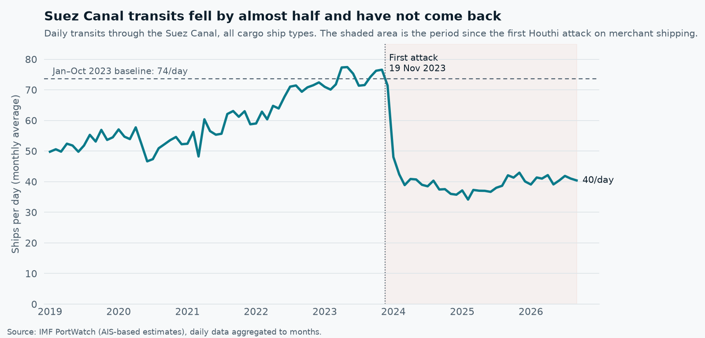
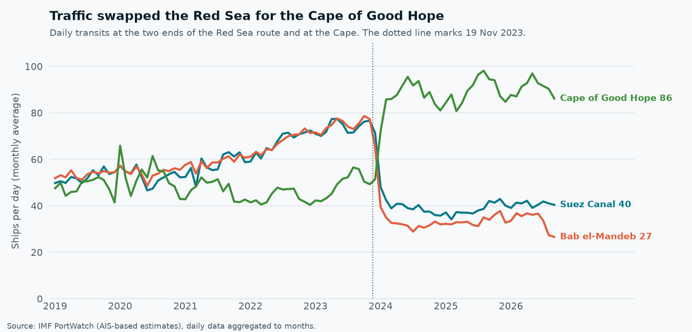
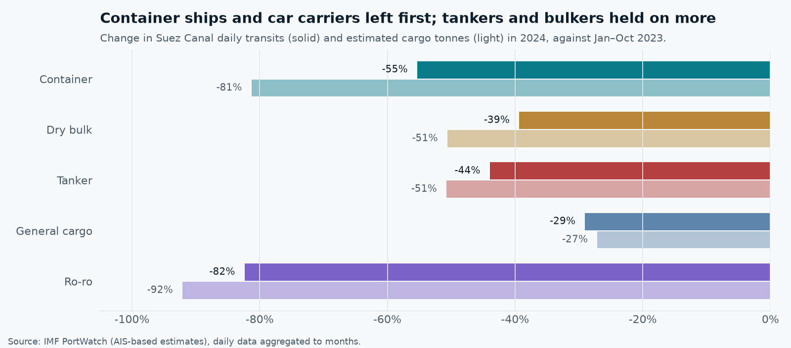
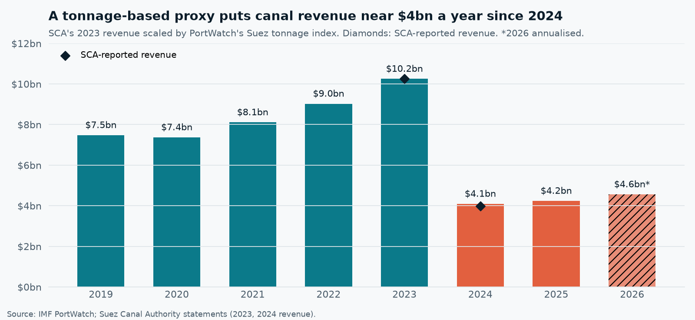
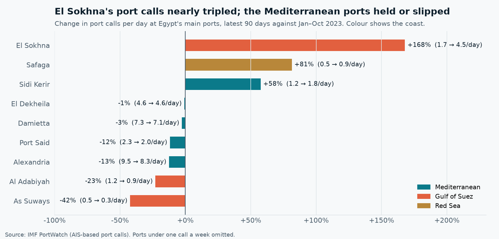

# Suez Canal & the Red Sea Crisis, 2019–2026 (IMF PortWatch)

**Daily AIS-based ship counts for the Suez Canal, the Red Sea route and Egypt's ports, pulled from IMF PortWatch into a bronze → silver → gold DuckDB warehouse, to answer: how far did Suez traffic fall after the Red Sea attacks, where did it go, which ships left, and what did it cost Egypt?**

[](https://www.python.org/)
[](https://duckdb.org/)
[](https://portwatch.imf.org/)



<p align="center"><b><a href="https://4maxr.github.io/suez-portwatch/dashboard.html">Open the interactive dashboard &rarr;</a></b><br>
<sub>Self-contained HTML · hover for exact values · route map · period and measure toggles · data tables · light &amp; dark</sub></p>

---

## Navigation

- [Key Insights](#key-insights)
- [Questions & Findings](#questions--findings)
- [Pipeline](#pipeline)
- [Data Model](#data-model)
- [Data Quality & Limitations](#data-quality--limitations)
- [Setup & Reproduction](#setup--reproduction)
- [Project Structure](#project-structure)

---

## Key Insights

All comparisons are against the **baseline**: January–October 2023, the ten months before the first Houthi attack on merchant shipping (19 Nov 2023). "Latest" is the 90 days from 12 Jul to 9 Oct 2026.

| # | Insight | Evidence |
|---|---------|----------|
| 1 | **Suez traffic halved and has not recovered.** 73.6 ships a day before the attacks, 39.6 in 2024 (−46%), 38.5 in 2025 and 41.3 in the latest 90 days (−44%). Estimated cargo is down 54–60%. | Q1 |
| 2 | **Ships were re-routed, not lost.** The Cape of Good Hope went from 48.9 to 88.9 ships a day (+82%), while Bab el-Mandeb lost 45.7 a day (−61%). Malacca, upstream in Asia, is flat (−0.1%). | Q2 |
| 3 | **The biggest ships left first.** Container transits fell 55% in 2024 but their cargo fell 81%. Container ships account for 42% of the cargo tonnes lost. The average Suez transit now carries 37.1 kt, against 45.7 kt before. | Q3 |
| 4 | **About $6bn a year of canal revenue is gone.** Scaling the SCA's reported 2023 revenue ($10.25bn) by PortWatch tonnage gives $4.09bn for 2024; the SCA reported $3.99bn (a 2.5% gap). The same proxy gives $4.2bn for 2025. | Q4 |
| 5 | **About 34,600 transits did not happen** between 19 Nov 2023 and 11 Oct 2026, carrying an estimated 2.0bn tonnes of cargo. | Q4 |
| 6 | **Egypt's own ports did not lose traffic overall.** El Sokhna's port calls rose from 1.7 to 4.5 a day (+168%). Damietta (−3%) and El Dekheila (−1%) held level; Alexandria and Port Said slipped about 12%. | Q4 |

---

## Questions & Findings

Every number below comes from a query in [`sql/analysis/`](sql/analysis). `scripts/run_analysis.py` writes the full result tables to `outputs/tables/`.

### Q1. How far did Suez transits fall, and have they recovered? — [`01_suez_decline.sql`](sql/analysis/01_suez_decline.sql)

| Period | Days | Ships / day | vs baseline | Cargo / day | vs baseline | Tonnes per ship |
|--------|-----:|------------:|------------:|------------:|------------:|----------------:|
| 2019 | 365 | 52.5 | −29% | 2.44 Mt | −27% | 46,600 |
| **Jan–Oct 2023 (baseline)** | 304 | **73.6** | – | **3.36 Mt** | – | 45,700 |
| 2024 | 366 | 39.6 | −46% | 1.34 Mt | −60% | 33,800 |
| 2025 | 365 | 38.5 | −48% | 1.39 Mt | −59% | 35,900 |
| Same 90 days of 2023 | 90 | 72.9 | −1% | 3.32 Mt | −1% | 45,600 |
| **Latest 90 days (2026)** | 90 | **41.3** | **−44%** | **1.53 Mt** | **−54%** | 37,100 |

- The drop happened within two months: monthly averages went from 77 transits a day in November 2023 to 48 in January 2024 and 39 in March.
- **There is no recovery yet.** The latest 90 days are 43% below the same 90 calendar days of 2023, so seasonality does not explain the gap. A small rise since mid-2025 stays within the range of the 2024 months.
- Tonnage fell further than ship counts, so the ships that stayed carry less each (see Q3).

### Q2. Where did the traffic go? — [`02_route_shift.sql`](sql/analysis/02_route_shift.sql), [`03_monthly_routes.sql`](sql/analysis/03_monthly_routes.sql)



| Chokepoint | Role | Baseline | 2024 | Latest 90 days | Change (latest) |
|------------|------|---------:|-----:|---------------:|----------------:|
| Suez Canal | Red Sea route, north end | 73.6 | 39.6 | 41.3 | −44% (−32 / day) |
| Bab el-Mandeb | Red Sea route, south end | 74.6 | 32.5 | 28.8 | −61% (−46 / day) |
| Cape of Good Hope | Diversion route | 48.9 | 87.0 | 88.9 | +82% (+40 / day) |
| Gibraltar | Mediterranean gateway | 146.2 | 133.3 | 130.7 | −11% |
| Malacca | Upstream control | 219.0 | 223.4 | 218.8 | −0.1% |

- The Cape gained about 40 ships a day and Bab el-Mandeb lost about 46. The two numbers are close, which fits ships swapping one route for the other. Against the same 90 days of 2023 (54.9 a day, a seasonal high) the Cape is still up 62%.
- **Malacca did not fall**, so Asia–Europe trade kept moving. The route changed, not the volume.
- Before the crisis Suez and Bab el-Mandeb moved together (73.6 vs 74.6 a day). Now Suez is 12 ships a day above Bab el-Mandeb. That suggests part of today's Suez traffic only travels between the Mediterranean and Red Sea ports (Jeddah, Aqaba, El Sokhna) without passing the southern strait. Transit counts alone cannot confirm the routing.
- Gibraltar is down 11%, which fits some Asia–Europe ships now reaching northern Europe round the Cape without entering the Mediterranean.

### Q3. Which vessel types left Suez the most? — [`04_vessel_mix.sql`](sql/analysis/04_vessel_mix.sql)



| Vessel type | Ships / day, baseline | 2024 | Latest | Ships, 2024 | Tonnes, 2024 | Share of tonnes lost |
|-------------|---------------------:|-----:|-------:|------------:|-------------:|---------------------:|
| Container | 19.6 | 8.7 | 10.2 | −55% | −81% | 42% |
| Dry bulk | 19.3 | 11.7 | 10.0 | −39% | −51% | 25% |
| Tanker | 25.6 | 14.3 | 16.0 | −44% | −51% | 31% |
| General cargo | 6.0 | 4.3 | 3.8 | −29% | −27% | 0.4% |
| Ro-ro | 3.2 | 0.6 | 1.3 | −82% | −92% | 0.6% |

- **Container ships and car carriers (ro-ro) left first and most.** For containers, cargo tonnes fell much more than ship counts, which means the largest container ships were the ones that diverted.
- Tankers became a larger share of what remains (35% → 39% of transits).
- One plausible explanation, which this data cannot test: container lines run fixed weekly loops and re-planned whole networks around Africa, while bulk and tanker voyages are booked one at a time and some still take the short route.

### Q4. What did it cost Egypt? — [`05_suez_annual_proxy.sql`](sql/analysis/05_suez_annual_proxy.sql), [`06_lost_transits.sql`](sql/analysis/06_lost_transits.sql), [`07_egypt_ports.sql`](sql/analysis/07_egypt_ports.sql)

**Canal revenue.** Canal tolls are charged on ship tonnage, so the proxy scales the Suez Canal Authority's reported 2023 revenue by PortWatch's cargo-tonnage index for each year.



| Year | Suez transits | Tonnage index (2023 = 1) | Revenue proxy | SCA reported |
|------|-------------:|-------------------------:|--------------:|-------------:|
| 2022 | 24,498 | 0.88 | $9.02bn | – |
| 2023 | 26,895 | 1.00 | $10.25bn (anchor) | $10.25bn |
| 2024 | 14,498 | 0.40 | $4.09bn | $3.99bn |
| 2025 | 14,070 | 0.41 | $4.24bn | – |
| 2026* | 11,590 | 0.44 | $4.56bn | – |

\*2026 runs to 11 Oct and is annualised.

- **The proxy holds up out of sample:** it gives $4.09bn for 2024 without using the 2024 figure, 2.5% above the $3.99bn the SCA reported.
- On that basis the canal has earned about **$6bn a year less** than in 2023 since the attacks began. Canal tolls are one of Egypt's main sources of foreign currency.
- **Transits that did not happen:** comparing each day since 19 Nov 2023 with the same month's baseline average gives about **34,600 missing transits** and **2.0bn tonnes** of cargo up to 11 Oct 2026 (12,400 transits in 2024, 12,800 in 2025 and 9,300 so far in 2026).

**Egypt's ports.** Ships that skip the canal also skip Egypt's transshipment hubs, so a fall in port calls was possible. Overall the data does not show one.



| Port | Coast | Calls / day, baseline | Latest | Change | Cargo / day, baseline | Latest | Change |
|------|-------|---------------------:|-------:|-------:|----------------------:|-------:|-------:|
| Alexandria | Mediterranean | 9.5 | 8.3 | −13% | 106 kt | 135 kt | +28% |
| Damietta | Mediterranean | 7.3 | 7.1 | −3% | 82 kt | 73 kt | −11% |
| El Dekheila | Mediterranean | 4.6 | 4.6 | −1% | 69 kt | 77 kt | +12% |
| Port Said | Mediterranean | 2.3 | 2.0 | −12% | 10 kt | 10 kt | −5% |
| **El Sokhna** | Gulf of Suez | 1.7 | 4.5 | **+168%** | 63 kt | 158 kt | **+152%** |
| Sidi Kerir | Mediterranean | 1.2 | 1.8 | +58% | 80 kt | 168 kt | +110% |

- **El Sokhna**, at the Red Sea end of the canal, nearly tripled its port calls, and its container calls rose from 0.8 to 1.9 a day. Part of that growth may reflect new terminal capacity, which PortWatch cannot see.
- **Sidi Kerir** is the Mediterranean end of the SUMED crude pipeline from the Gulf of Suez. Its rise fits more crude moving by pipeline instead of by tanker through the canal, but port counts alone cannot prove that link.
- Alexandria's calls slipped while its cargo tonnes rose (+28%), so fewer but fuller ships are calling.

### Q5. Can the data be trusted? — [`09_data_quality.sql`](sql/analysis/09_data_quality.sql), [`10_outlier_days.sql`](sql/analysis/10_outlier_days.sql)

See [Data Quality & Limitations](#data-quality--limitations). The headline checks: **PortWatch counted 26,895 Suez transits in 2023 and the SCA reported 26,434 (+1.7%)**, and the outlier query finds the **Ever Given** grounding without being told: on 25 March 2021 only 2 ships crossed, against a 15-day median of 48.

---

## Pipeline

```
IMF PortWatch API ──► data/raw/*.json ──► bronze ──► silver ──► gold ──► sql/analysis ──► tables, charts, dashboard
   (extract.py)        16 year files      as-is     typed,     star       10 queries
                                                    deduped    schema
```

| Step | Script | What it does |
|------|--------|--------------|
| 1 | `scripts/extract.py` | Downloads two PortWatch daily layers, one file per year, paging 1,000 rows at a time. Each download is checked against the server's record count. Closed years (data to 31 Dec) are kept; the current year is refreshed on every run. |
| 2 | `scripts/build_warehouse.py` | Runs `sql/bronze`, `sql/silver` and `sql/gold` in order into `data/suez_portwatch.duckdb`. |
| 3 | `scripts/run_analysis.py` | Runs every `sql/analysis/*.sql` query, saves the results as CSV and draws the README figures. |
| 4 | `scripts/build_dashboard.py` | Exports the dashboard data and renders `docs/dashboard.html` from `scripts/dashboard_template.html`. |

| Layer | PortWatch service | Filter | Rows |
|-------|-------------------|--------|-----:|
| `chokepoint_transits` | `Daily_Chokepoints_Data` | all 28 chokepoints | 79,548 |
| `egypt_port_calls` | `Daily_Ports_Data` | the 13 Egyptian ports (`portid IN (...)`) | 36,907 |
| reference | `PortWatch_chokepoints_database`, `PortWatch_ports_database` | chokepoints; Egyptian ports | 28 + 13 |

The layers are public ArcGIS FeatureServer endpoints under `services9.arcgis.com/weJ1QsnbMYJlCHdG/arcgis/rest/services`. No key or sign-in is needed. The port layer rejects an `ISO3` filter (it is not indexed on a table of about 750,000 rows per year), so the extractor filters by the port IDs from the reference layer instead.

## Data Model

**Gold layer (star schema):**

- `fact_chokepoint_transits`: date × chokepoint × vessel type → transits and estimated cargo tonnes (397,740 rows)
- `fact_port_calls`: date × Egyptian port × vessel type → port calls, import and export tonnes (184,535 rows)
- `dim_chokepoint`: 28 chokepoints with coordinates and a `route_role` for the five on the Asia–Europe corridor
- `dim_port`: 13 Egyptian ports with LOCODE, coordinates, coast (Mediterranean / Gulf of Suez / Red Sea) and PortWatch's share of Egypt's maritime trade
- `dim_vessel_type`: container, dry bulk, tanker, general cargo, ro-ro
- `dim_date`: every day from 1 Jan 2019, with month and week
- `dim_period`: the analysis windows (2019, baseline, 2024, 2025, latest 90 days and the same 90 days of 2023)

---

## Data Quality & Limitations

Checked by [`09_data_quality.sql`](sql/analysis/09_data_quality.sql), [`10_outlier_days.sql`](sql/analysis/10_outlier_days.sql) and [`tests/test_warehouse.py`](tests/test_warehouse.py) (13 tests):

- **Completeness:** all 28 chokepoints have a record for every day from 1 Jan 2019 to 11 Oct 2026, and all 13 Egyptian ports for every day to 9 Oct 2026. There are no duplicate place-day keys in silver or gold.
- **Reconciliation:** the five vessel-type columns sum exactly to PortWatch's published ship totals on every day. Tonnage differs by at most 4 t, from rounding each column to whole tonnes.
- **External check:** PortWatch's 2023 Suez count is within 1.7% of the Suez Canal Authority's (26,895 vs 26,434). For 2024 PortWatch counts 14,498 against the SCA's 13,213 (+9.7%). The definitions differ (PortWatch's 48-hour rule, cargo types only), and the data cannot say why the gap widened in 2024.
- **No zero days** at any of the five route chokepoints, so no AIS blackout is hiding inside the averages.
- **Outliers:** 87 days differ from their 15-day median by more than 50%. 65 are at the Cape of Good Hope, where AIS reception is patchier, and 14 at Suez, including the Ever Given blockage (24–28 March 2021). All findings use monthly or multi-month averages, so single days do not drive them.
- **Estimates, not manifests.** Ship counts come from AIS tracks, and cargo tonnes are modelled from draft and deadweight tonnage. Neither is a customs or canal record.
- **Five cargo types only.** Passenger ships, naval vessels and small craft are not counted, and LNG carriers sit inside "tanker".
- **Revenue is a proxy.** It assumes revenue moves with tonnage. Toll rates, rebates and the mix of ship sizes changed after 2023, so treat it as a scale estimate. The two SCA figures (2023, 2024) come from the authority's public statements and are set in `config.py`.
- **Timing, not proof of cause.** The drop lines up with the attacks, but the data cannot separate the security effect from freight rates, insurance costs or carrier network decisions. Event markers on the charts are news context, not derived from PortWatch.
- **Port boundaries are PortWatch's.** Port Said may combine the east and west terminals. Ports averaging under one call a week (As Suways and Safaga are kept; Ras Gharib, Ras Shukheir, Zeit Bay and the Egyptian LNG terminal are not) stay in the gold layer but are left out of the port comparison.
- **The baseline is ten months.** Jan–Oct 2023 has no November or December, so the "lost transits" estimate uses the ten-month average for those two months.

---

## Setup & Reproduction

Requires [uv](https://docs.astral.sh/uv/). No API key or account is needed.

```bash
uv sync
uv run python scripts/extract.py          # ~15 min on first run (about 150 API requests); later runs refresh only the current year
uv run python scripts/build_warehouse.py
uv run python scripts/run_analysis.py
uv run python scripts/build_dashboard.py  # writes docs/dashboard.html (self-contained, no dependencies)
uv run pytest
uv run ruff check .
```

The analysis windows, the route chokepoints and the SCA anchor figures are set in [`src/suez_portwatch/config.py`](src/suez_portwatch/config.py). The "latest 90 days" window moves forward automatically as new data arrives.

## Project Structure

```
suez-portwatch/
├── src/suez_portwatch/
│   ├── config.py        # paths, layers, chokepoints, periods, SCA anchor figures
│   ├── portwatch.py     # ArcGIS client: paging, retries, record-count check
│   ├── extract.py       # layers × years → data/raw/*.json (incremental)
│   ├── warehouse.py     # runs the SQL layers, query helper
│   └── charts.py        # README figures
├── sql/
│   ├── bronze/          # raw JSON → tables
│   ├── silver/          # typed, deduped, one row per place per day
│   ├── gold/            # star schema
│   └── analysis/        # one file per question
├── scripts/             # extract → build → analyse → dashboard
├── tests/               # data-quality tests
├── docs/dashboard.html  # interactive dashboard
└── outputs/charts/      # figures used above
```

---

**Data:** IMF PortWatch (Arslanalp, Koepke & Verschuur, *Tracking Trade from Space*, IMF Working Paper 2021/225), used under the [IMF terms of use](https://www.imf.org/external/terms.htm). Suez Canal Authority revenue and transit figures for 2023 and 2024 are from its public statements.

**Author:** Mustafa Al-Rouby, logistics & supply chain data analyst, 9+ years in customs and operations.
